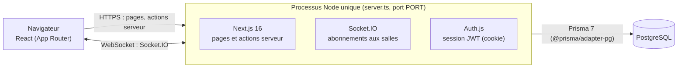
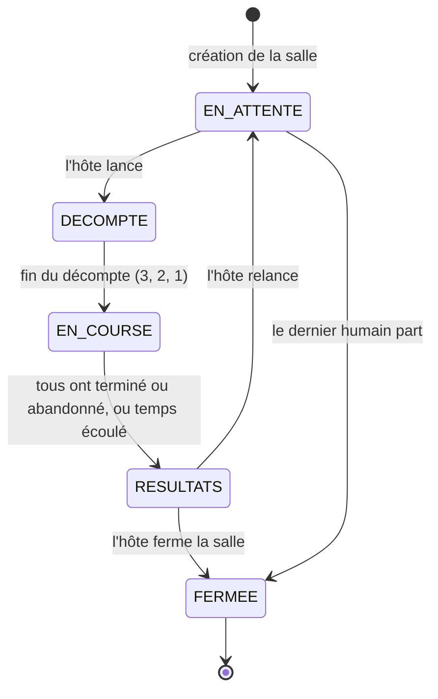
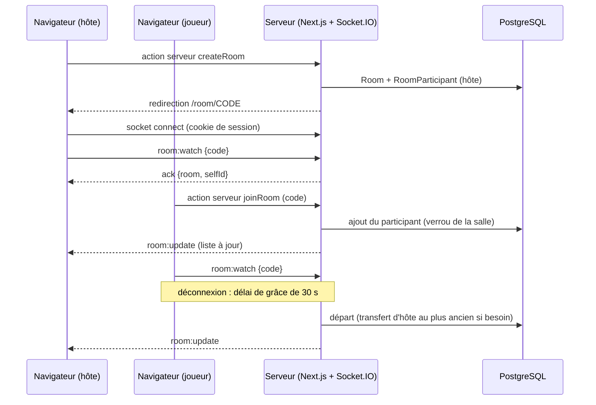

# Architecture

Version initiale (checkpoint 1). Ce document regroupe l'architecture de Keyclue et renvoie aux
documents détaillés. Ce qui est **implémenté** et ce qui est **prévu** est toujours distingué ;
l'état de chaque exigence est suivi dans la [matrice](EXIGENCES.md).

## 1. Vue d'ensemble

- **Un seul processus, un seul port** : `server.ts` sert Next.js et intercepte `/socket.io/`
  ([ADR 0002](adr/0002-temps-reel-socketio.md)). Hébergé sur Railway, HTTPS automatique
  ([ADR 0001](adr/0001-hebergement-railway.md)) ; migrations appliquées au démarrage
  ([ADR 0008](adr/0008-migrations-au-demarrage.md)).
- **Identité** : Auth.js (GitHub, Discord, nom d'utilisateur + mot de passe, invité), session JWT
  dans un cookie chiffré ([ADR 0004](adr/0004-authentification-authjs.md)). Socket.IO relit ce même
  cookie à la connexion : le navigateur n'envoie jamais son identité
  ([ADR 0007](adr/0007-identite-socketio-session-authjs.md)).
- **Serveur autoritaire** : toute modification d'une salle passe par le service
  `src/lib/rooms/service.ts`, sous verrou de la ligne `Room` (`SELECT … FOR UPDATE`). Les clients
  n'envoient que des intentions.

| Dossier | Rôle |
|---|---|
| `server.ts`, `src/server/` | Démarrage, variables d'environnement, Socket.IO (identité, abonnements, départs différés). |
| `src/app/` | Pages et routes (App Router). |
| `src/lib/rooms/` | Domaine des salles : codes, service, stockage (Prisma en production, mémoire pour les tests), événements typés. |
| `src/lib/auth/`, `src/auth.ts` | Règles de validation, hachage scrypt, configuration Auth.js. |
| `src/i18n/` | Textes FR/EN, formatage, langue et thème ([ADR 0009](adr/0009-langue-et-theme.md)). |

## 2. Modèle de données

Détail, tables actuelles et tables prévues : [architecture/modele-de-donnees.md](architecture/modele-de-donnees.md).
Source de vérité : `prisma/schema.prisma`.

Tables actuelles : `User`, `Account`, `Room`, `RoomParticipant`. Les invités n'ont pas de ligne
`User` ; ils n'existent que dans leur cookie de session et, le temps de leur présence, dans
`RoomParticipant`.

## 3. Machine à états d'une course (COURSE-01)

Détail des déclencheurs et de ce qui est implémenté : [architecture/machine-a-etats.md](architecture/machine-a-etats.md).

Aujourd'hui, seul `EN_ATTENTE` est utilisé ; une salle vide est supprimée (équivalent de `FERMEE`).

## 4. Temps réel

### Choix de la technologie

[ADR 0002](adr/0002-temps-reel-socketio.md) : **Socket.IO** sur le même serveur Node que Next.js.
Écartés : services externes (interdits), WebSocket natif `ws` (reconnexion, salles et accusés de
réception à recoder), SSE et polling (sens unique ou trop lents), serveur Socket.IO séparé (deux
services, CORS).

### Flux actuels (implémentés)

Les événements sont typés des deux côtés dans `src/lib/rooms/events.ts`.

- `room:watch` (client → serveur, avec accusé) : s'abonner à une salle dont on fait déjà partie ;
  refusé sinon.
- `room:update` (serveur → clients de la salle) : liste publique des personnes présentes (sans
  identifiant de session), ou `null` si la salle est fermée.
- Les arrivées et départs passent par des **actions serveur** Next.js ; elles publient ensuite
  `room:update` via l'instance Socket.IO partagée (`src/server/realtime.ts`).

### Flux prévus pour la course (non implémentés)

Noms indicatifs, à confirmer à l'implémentation.

| Événement | Sens | Contenu | Exigences |
|---|---|---|---|
| `room:config` | serveur → salle | configuration courante, à chaque changement par l'hôte | CONF-12 |
| `race:countdown` | serveur → salle | texte et heure de départ (horloge serveur) | COURSE-03 |
| `race:input` | client → serveur | frappes depuis le dernier envoi ; le serveur recalcule la progression et rejette l'impossible | COURSE-06 |
| `race:state` | serveur → salle | positions, MPM et état de chacun, regroupés environ toutes les 200 ms | COURSE-05, PERF-02 |
| `race:bonus` | serveur → salle | bonus attribué, cible et effet | BONUS-03 |
| `race:results` | serveur → salle | classement final | COURSE-10 |

Le serveur est la source de vérité : il horodate le départ et la fin, calcule la progression et le
classement, applique les bonus (COURSE-06). Les clients interpolent les positions entre deux
`race:state` pour un mouvement fluide.

## 5. Gestion des bots (approche prévue)

Rien n'est implémenté. Un ADR consignera la décision finale à l'implémentation.

- **Côté serveur uniquement.** Un bot est un participant de course sans compte ni socket. Sa
  progression passe par le **même chemin** que celle d'un humain : validation, classement, bonus et
  malus (BOT-04). L'interface l'identifie par un badge « bot » et son niveau.
- **Moteur pur et déterministe (BOT-05).** Module sans dépendance au réseau ni à l'horloge
  (`src/lib/bots/`) : à partir du texte, du niveau, du mode d'erreur et d'une **graine**, il
  produit pas à pas les frappes du bot (caractère juste, erreur, correction) avec leur délai. Un
  générateur pseudo-aléatoire à graine (ex. mulberry32) remplace `Math.random`. Mêmes entrées et
  même graine = même course : testable unitairement.
- **Simulation incrémentale.** La boucle de course du serveur fait avancer chaque bot jusqu'à
  l'instant courant, à chaque tick. Le texte peut changer en cours de course (bonus +3 / −3 mots) ;
  une simulation pas à pas suit le texte à jour, ce qu'une chronologie précalculée ne permettrait pas.
- **Vitesse variable (BOT-02).** MPM de base tiré dans la plage du niveau, puis modulé : mot
  difficile (long, rare, ponctuation, accents) plus lent, courtes accélérations, hésitations
  aléatoires entre les mots.
- **Erreurs (BOT-03).** Probabilité d'erreur par caractère selon le niveau. En mode
  « correction obligatoire », le bot s'arrête, efface et retape (temps de correction) ; en mode
  « libre », il continue et l'erreur est comptée.
- **Niveaux (BOT-01).** Valeurs de départ, reprises de l'énoncé et à calibrer par les tests :

| Niveau | MPM visé | Taux d'erreur |
|---|---|---|
| Noob | 10–20 | ~12 % |
| Débutant | 20–35 | ~8 % |
| Intermédiaire | 35–60 | ~5 % |
| Expert | 70–100 | ~2 % |
| Impossible | 140+ | ~0,5 % |

## 6. Décisions (ADR)

| ADR | Sujet |
|---|---|
| [0001](adr/0001-hebergement-railway.md) | Hébergement Railway |
| [0002](adr/0002-temps-reel-socketio.md) | Temps réel fait maison avec Socket.IO |
| [0003](adr/0003-prisma-postgresql.md) | Prisma et PostgreSQL |
| [0004](adr/0004-authentification-authjs.md) | Authentification Auth.js |
| [0005](adr/0005-conflits-noms-utilisateur-oauth.md) | Conflits de noms d'utilisateur OAuth |
| [0006](adr/0006-salles-transfert-hote.md) | Salles et transfert d'hôte |
| [0007](adr/0007-identite-socketio-session-authjs.md) | Identité Socket.IO tirée de la session Auth.js |
| [0008](adr/0008-migrations-au-demarrage.md) | Migrations au démarrage |
| [0009](adr/0009-langue-et-theme.md) | Langue et thème |
| [0010](adr/0010-direction-artistique-keyclue.md) | Direction artistique Keyclue |
| [0011](adr/0011-animations-motion.md) | Animations et budget de performance |
