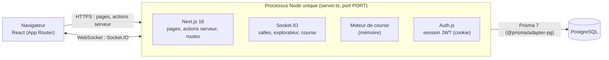
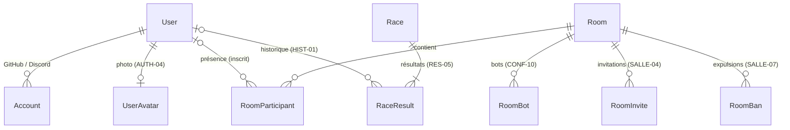
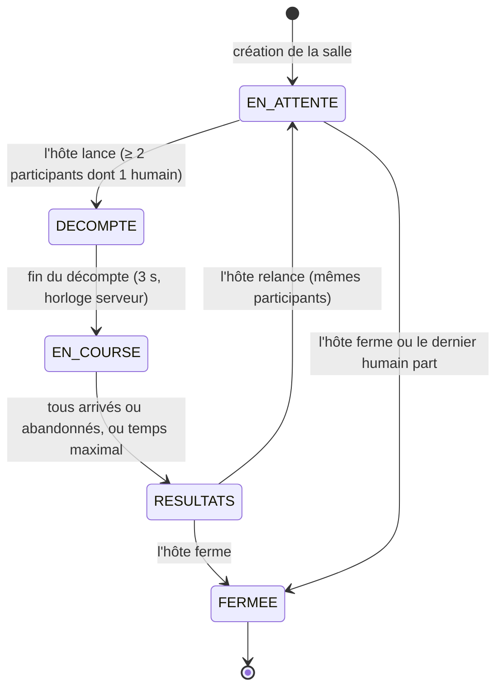
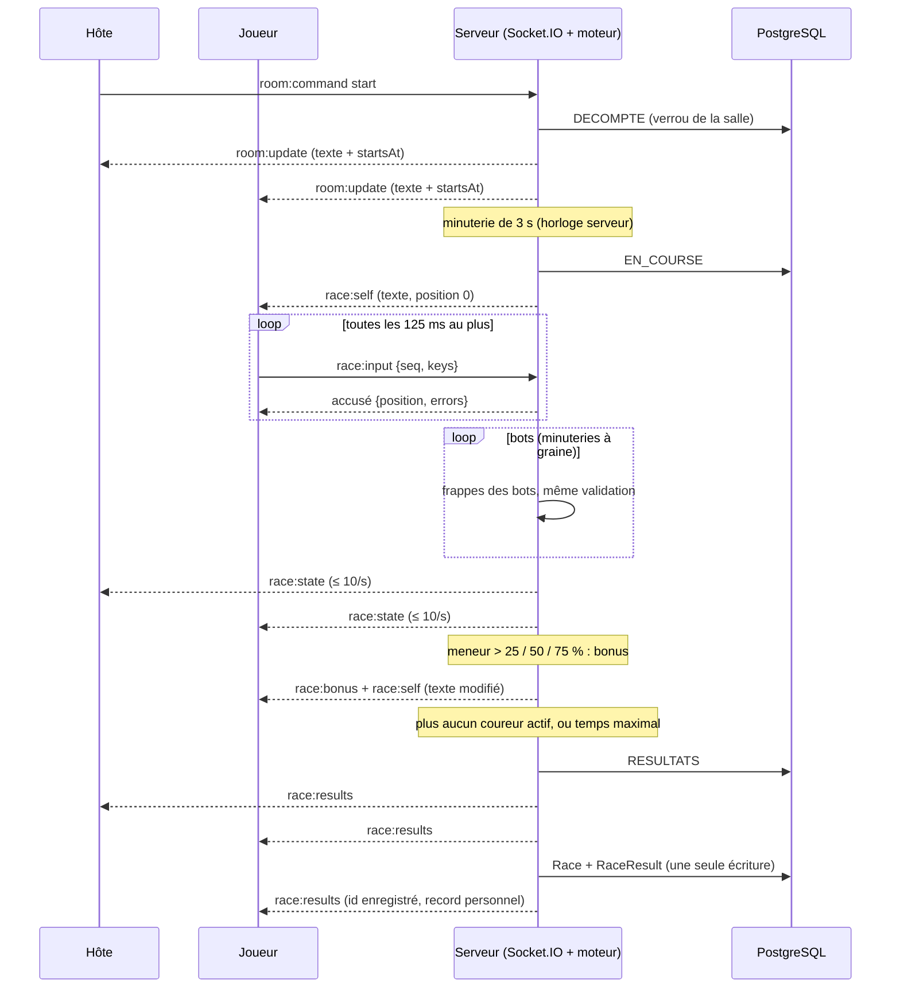

# Architecture

Version finale (remise finale). Ce document regroupe l'architecture de Keyclue et renvoie aux
documents détaillés. L'état de chaque exigence, avec ce qui reste partiel, est suivi dans la
[matrice](EXIGENCES.md).

## 1. Vue d'ensemble

- **Un seul processus, un seul port** : `server.ts` sert Next.js et intercepte `/socket.io/`
  ([ADR 0002](adr/0002-temps-reel-socketio.md)). Hébergé sur Railway, HTTPS automatique
  ([ADR 0001](adr/0001-hebergement-railway.md)) ; migrations et corpus appliqués au démarrage
  ([ADR 0008](adr/0008-migrations-au-demarrage.md), [ADR 0013](adr/0013-seed-au-demarrage.md)).
- **Identité** : Auth.js (GitHub, Discord, nom d'utilisateur + mot de passe, invité), session JWT
  dans un cookie chiffré ([ADR 0004](adr/0004-authentification-authjs.md)). Socket.IO relit ce même
  cookie : le navigateur n'envoie jamais son identité
  ([ADR 0007](adr/0007-identite-socketio-session-authjs.md)).
- **Serveur autoritaire** : toute modification d'une salle passe par `src/lib/rooms/service.ts`,
  sous verrou de la ligne `Room` (`SELECT … FOR UPDATE`) ; les commandes de l'hôte sont validées
  par Zod et l'hôte est revérifié côté serveur. Pendant la course, le client n'envoie que ses
  frappes ; le serveur calcule positions, classement et bonus
  ([ADR 0018](adr/0018-moteur-de-course-serveur.md)).

| Dossier | Rôle |
|---|---|
| `server.ts`, `src/server/` | Démarrage, variables d'environnement, Socket.IO (identité, abonnements, départs différés), exécution des courses (`race-runtime.ts`). |
| `src/app/` | Pages et routes (App Router) : accueil, salles, explorateur, invitations, résultats, historique, profil, avatars, santé. |
| `src/lib/rooms/` | Domaine des salles : codes, machine à états, service, accès, stockage (Prisma, ou mémoire pour les tests), événements typés. |
| `src/lib/race/` | Logique pure de course : mesures, classement, bonus, moteur, tampon de frappes, persistance des résultats. |
| `src/lib/bots/` | Moteur des bots, pur et déterministe ([ADR 0015](adr/0015-moteur-des-bots.md)). |
| `src/lib/text/` | Génération du texte de course ([ADR 0016](adr/0016-generation-du-texte.md)). |
| `src/lib/auth/`, `src/auth.ts`, `src/lib/profile/` | Validation, hachage scrypt, Auth.js, profil et photos ([ADR 0019](adr/0019-photos-de-profil-et-pseudonyme.md)). |
| `src/i18n/` | Textes FR/EN, formatage `Intl`, langue et thème ([ADR 0009](adr/0009-langue-et-theme.md), [ADR 0014](adr/0014-langue-du-navigateur.md)). |

## 2. Modèle de données

Détail et diagramme Mermaid complet : [architecture/modele-de-donnees.md](architecture/modele-de-donnees.md).
Source de vérité : `prisma/schema.prisma`.

`Passage` et `Word` (corpus des textes) sont indépendants. Les invités n'ont pas de ligne `User` :
ils n'existent que dans leur cookie de session et, le temps de leur présence, dans
`RoomParticipant`. Une course n'est enregistrée (`Race` + une ligne `RaceResult` par coureur,
invités et bots compris, sans `userId`) que si au moins un inscrit y a couru, une seule fois, en fin
de course.

## 3. Machine à états d'une course (COURSE-01)

Détail des déclencheurs : [architecture/machine-a-etats.md](architecture/machine-a-etats.md).
Code : `src/lib/rooms/state-machine.ts` (transitions refusées hors de ce graphe).

Au redémarrage du serveur, une salle en `DECOMPTE` ou `EN_COURSE` revient en `EN_ATTENTE` : la
course, gardée en mémoire, est perdue.

## 4. Temps réel

### Choix de la technologie

[ADR 0002](adr/0002-temps-reel-socketio.md) : **Socket.IO** sur le même serveur Node que Next.js.
Écartés : services externes (interdits), WebSocket natif `ws` (reconnexion, salles et accusés de
réception à recoder), SSE et polling (sens unique ou trop lents), serveur Socket.IO séparé (deux
services, CORS).

### Événements

Typés des deux côtés dans `src/lib/rooms/events.ts` ; entrées validées par Zod
(`src/lib/rooms/schemas.ts`).

| Événement | Sens | Contenu | Exigences |
|---|---|---|---|
| `room:watch` | client → serveur (accusé) | s'abonner à sa salle ; l'accusé renvoie la salle, son id, et pendant une course son texte, sa position et la piste (reprise) | JOIN-01, COURSE-08 |
| `room:update` | serveur → salle | salle publique (participants, configuration, bots, état, course, résultats) ou `null` si fermée | CONF-12, COURSE-01 |
| `room:removed` | serveur → personne | expulsé ou retiré de la salle | SALLE-07 |
| `room:command` | client → serveur (accusé) | commande de l'hôte : `configure`, `configureAccess`, `addBot`, `removeBot`, `start`, `reset`, `close`, `kick`, `createInvites`, `listInvites` | SEC-01 |
| `lobby:watch` / `lobby:update` | client ↔ serveur | explorateur des salles publiques en direct | JOIN-02 |
| `race:input` | client → serveur (accusé) | `{ seq, keys }` : au plus 20 caractères, au plus 10 messages/s par joueur ; l'accusé renvoie la position validée | COURSE-06, PERF-02 |
| `race:abandon` | client → serveur (accusé) | abandon confirmé | COURSE-07 |
| `race:state` | serveur → salle | piste : position, progression, MPM et statut de chaque coureur, au plus toutes les 100 ms, seulement si changé | COURSE-05 |
| `race:self` | serveur → coureur | son texte courant (modifié par les bonus), sa position, ses erreurs, son brouillard | BONUS-02 |
| `race:bonus` | serveur → salle | bonus accordé : type, bénéficiaire, cible, point de contrôle | BONUS-03 |
| `race:results` | serveur → salle | classement final et statistiques, puis enrichi (id enregistré, record) | COURSE-10, RES-01 à 05 |

### Flux d'une course

- **Côté client**, les frappes sont prédites immédiatement puis regroupées (au plus toutes les
  125 ms, 20 caractères par message) ; l'accusé du serveur fait foi. La piste interpole les
  positions entre deux `race:state`.
- **Déconnexion** : en salle d'attente, départ après 30 s ([ADR 0006](adr/0006-salles-transfert-hote.md)) ;
  pendant une course, la position est gardée 30 s, puis le coureur abandonne et quitte la salle.
- Les arrivées et départs passent aussi par des **actions serveur** Next.js, qui publient ensuite
  via l'instance Socket.IO partagée (`src/server/realtime.ts`).

## 5. Gestion des bots

[ADR 0015](adr/0015-moteur-des-bots.md) (moteur) et [ADR 0018](adr/0018-moteur-de-course-serveur.md)
(exécution).

- **Moteur pur et déterministe** (`src/lib/bots/`) : `createBotRunner({ level, seed, errorMode })`
  renvoie la prochaine frappe `{ delayMs, correct }` à partir du texte et de la position courants.
  Générateur pseudo-aléatoire maison à graine, jamais `Math.random` : même graine, même course.
- **Exécution serveur** (`src/server/race-runtime.ts`) : chaque bot a sa minuterie ; sa graine est
  dérivée de la graine de course et de son id. Ses frappes passent par **la même validation** que
  celles d'un humain : bonus et malus s'appliquent pareil, et un texte allongé ou raccourci est relu
  à chaque frappe.
- **Vitesse variable** : MPM de base tiré dans la plage du niveau, rythme propre à chaque mot,
  ralentissement sur les mots difficiles (longueur, ponctuation, chiffres, majuscules, accents),
  hésitations sur 6 % des mots puis accélération.
- **Erreurs** : mode « correction obligatoire », la frappe fausse n'avance pas et la correction
  coûte du temps ; mode « libre », l'erreur est comptée et le bot avance.
- **Niveaux** (`src/lib/bots/levels.ts`) :

| Niveau | MPM nets | Taux d'erreur |
|---|---|---|
| Noob | 10–20 | 12 % |
| Débutant | 20–35 | 8 % |
| Intermédiaire | 35–60 | 5 % |
| Expert | 70–100 | 2 % |
| Impossible | 140–170 | 0,5 % |

## 6. Décisions (ADR)

| ADR | Sujet |
|---|---|
| [0001](adr/0001-hebergement-railway.md) | Hébergement Railway |
| [0002](adr/0002-temps-reel-socketio.md) | Temps réel fait maison avec Socket.IO |
| [0003](adr/0003-prisma-postgresql.md) | Prisma et PostgreSQL |
| [0004](adr/0004-authentification-authjs.md) | Authentification Auth.js |
| [0005](adr/0005-conflits-noms-utilisateur-oauth.md) | Conflits de noms d'utilisateur OAuth |
| [0006](adr/0006-salles-transfert-hote.md) | Salles et transfert d'hôte |
| [0007](adr/0007-identite-socketio-session-authjs.md) | Identité Socket.IO tirée de la session Auth.js |
| [0008](adr/0008-migrations-au-demarrage.md) | Migrations au démarrage |
| [0009](adr/0009-langue-et-theme.md) | Langue et thème |
| [0010](adr/0010-direction-artistique-keyclue.md) | Direction artistique Keyclue |
| [0011](adr/0011-animations-motion.md) | Animations et budget de performance |
| [0012](adr/0012-limitation-tentatives-et-liaison-oauth.md) | Limitation des tentatives de connexion et refus de la liaison OAuth |
| [0013](adr/0013-seed-au-demarrage.md) | Corpus et comptes de démonstration chargés au démarrage |
| [0014](adr/0014-langue-du-navigateur.md) | Langue du navigateur par défaut |
| [0015](adr/0015-moteur-des-bots.md) | Moteur des bots |
| [0016](adr/0016-generation-du-texte.md) | Génération du texte |
| [0017](adr/0017-acces-aux-salles.md) | Accès aux salles : visibilité, invitations, expulsion, partie rapide |
| [0018](adr/0018-moteur-de-course-serveur.md) | Moteur de course côté serveur |
| [0019](adr/0019-photos-de-profil-et-pseudonyme.md) | Photos de profil et pseudonyme d'affichage |
