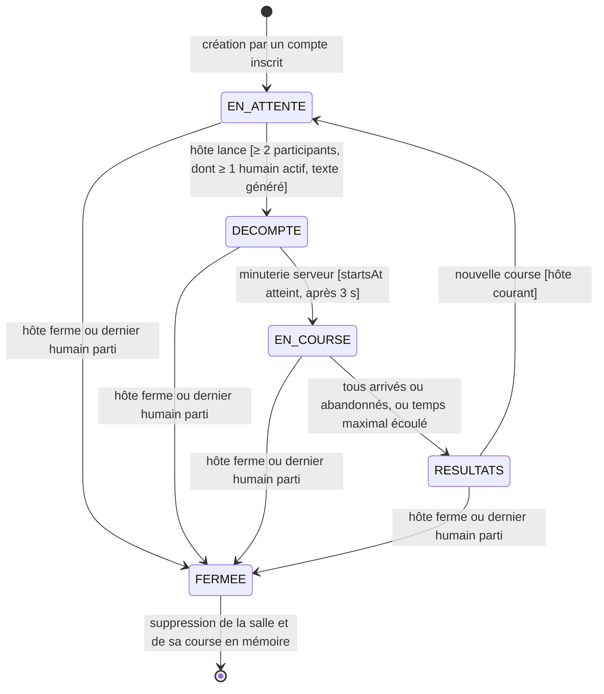

# Machine à états d'une salle (COURSE-01)

Le champ `Room.status` contient `EN_ATTENTE`, `DECOMPTE`, `EN_COURSE`, `RESULTATS` ou
`FERMEE`. Les transitions sont définies par `src/lib/rooms/state-machine.ts` et exécutées
par le service sous verrou de la ligne `Room`. Une transition invalide renvoie
`roomInvalidTransition`. L'identité vient de la session Auth.js et l'hôte courant est
vérifié côté serveur, sous le même verrou.

- Les bots comptent dans les deux participants requis et dans la capacité ; les
  spectateurs ne comptent dans aucun de ces deux seuils. Au moins un humain non
  spectateur doit courir. Un spectateur reste un humain présent pour la fermeture.
- Le lancement génère le texte avec `loadRaceText` et une graine `crypto.randomInt`.
  En cas de `NOT_ENOUGH_WORDS` ou `NO_PASSAGE`, la salle reste en attente et l'hôte
  reçoit un code d'erreur. Aucun texte n'est exposé en attente.
- Le texte et `startsAt` (millisecondes Unix, horloge serveur) sont diffusés dans
  `room:update` dès le début du décompte et conservés seulement en mémoire serveur.
  `serverNow` permet aux clients d'afficher le décompte même si leurs horloges diffèrent.
  La minuterie serveur passe en course après trois secondes. La limite optionnelle
  commence à `startsAt`, pas au début du décompte.
- Le runtime serveur détient les frappes humaines et les minuteries des bots. Il appelle
  `finishRace` quand il ne reste aucun coureur actif, ou après expiration du temps maximal.
  Le classement et les statistiques restent en mémoire et dans `PublicRoom.results`
  en `RESULTATS`, jusqu'au reset ou à la fermeture ; aucune persistance des résultats.
- L'hôte peut modifier la configuration et ajouter/retirer des bots en `EN_ATTENTE`
  et `RESULTATS` seulement. Ces changements sont persistés et diffusés à toute la salle.
  Une nouvelle course conserve participants, bots et configuration, et efface texte et résultats.
- On rejoint une salle en attente ou aux résultats ; un participant déjà présent peut se
  reconnecter. En course, la déconnexion conserve sa position pendant 30 s, puis le marque
  abandonné sans retirer sa présence. `room:watch` restitue son texte modifié et sa position.
  Hors course, le départ conserve le délai de grâce et le transfert d'hôte existants.
  Les bots ne deviennent jamais hôtes.
- Fermer la salle, ou retirer le dernier humain, passe par `FERMEE` puis supprime la
  salle et annule sa minuterie. `room:update: null` informe tous les abonnés.
- Au redémarrage du processus, texte et minuteries sont perdus ; les présences
  persistées bénéficient du délai de grâce existant. L'hôte peut fermer la salle.
