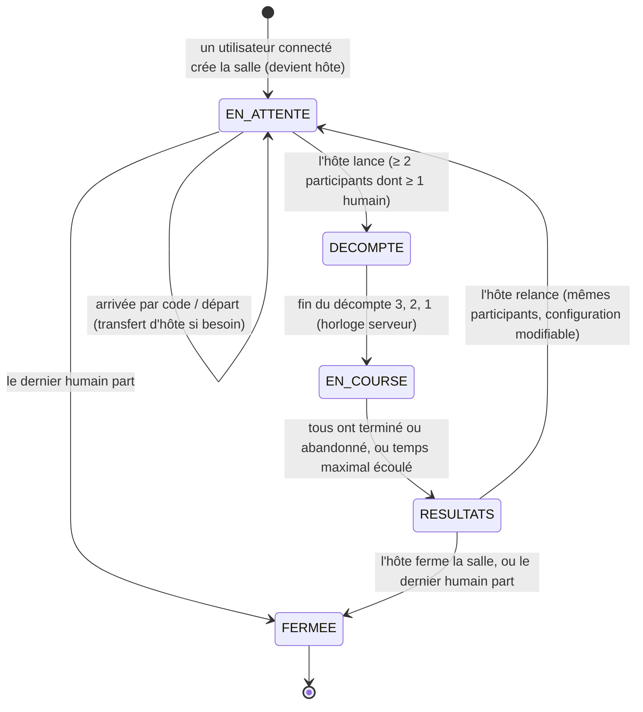

# Machine à états d'une course (COURSE-01)

Champ `Room.status` ([modèle de données](modele-de-donnees.md)). États exigés par COURSE-01 :
`EN_ATTENTE → DECOMPTE → EN_COURSE → RESULTATS → (EN_ATTENTE | FERMEE)`.

L'énumération Prisma contient aujourd'hui `EN_ATTENTE`, `EN_COURSE` et `TERMINEE` ; **seul
`EN_ATTENTE` est utilisé**. `DECOMPTE`, `RESULTATS` et `FERMEE` seront ajoutés (et `TERMINEE`
renommé `RESULTATS`) par la migration qui implémentera la course.

## Déclencheurs

| Transition | Qui | Condition | Exigence | Statut |
|---|---|---|---|---|
| création → `EN_ATTENTE` | utilisateur connecté (pas un invité) | — | SALLE-01, AUTH-03 | **Implémenté** |
| arrivée dans `EN_ATTENTE` | utilisateur ou invité | code valide, salle en attente | JOIN-01, SALLE-09 | **Implémenté** (par code) |
| départ dans `EN_ATTENTE` | participant (bouton) ou serveur (déconnexion > 30 s) | — | SALLE-08 | **Implémenté**, avec transfert d'hôte au plus ancien |
| `EN_ATTENTE` → `DECOMPTE` | hôte | ≥ 2 participants dont ≥ 1 humain ; les bots comptent, pas les spectateurs | COURSE-02 | Prévu |
| `DECOMPTE` → `EN_COURSE` | serveur | fin du décompte ; le texte est révélé au début du décompte | COURSE-03 | Prévu |
| `EN_COURSE` → `RESULTATS` | serveur | tous ont terminé ou abandonné, ou temps maximal écoulé | COURSE-09 | Prévu |
| `RESULTATS` → `EN_ATTENTE` | hôte | — | COURSE-11 | Prévu |
| `RESULTATS` → `FERMEE` | hôte (bouton) | — | COURSE-11 | Prévu |
| → `FERMEE` | serveur | dernier humain parti | SALLE-08 | **Implémenté** sous forme de **suppression** de la salle |

## Notes

- **`FERMEE` n'existe pas encore** dans l'énumération : aujourd'hui une salle vide est supprimée
  ([ADR 0006](../adr/0006-salles-transfert-hote.md)). Garder la salle à l'état `FERMEE` ou continuer
  à la supprimer (les résultats de course, HIST-01, n'en dépendraient pas) sera décidé dans un ADR
  avec COURSE-11.
- On ne rejoint qu'une salle `EN_ATTENTE` : le service refuse déjà les autres états
  (`roomNotWaiting`, testé dans `src/lib/rooms/service.test.ts`).
- Toute transition passe par le serveur, sous verrou de la ligne `Room` (`SELECT … FOR UPDATE`).
  Les clients n'envoient que des intentions ; leur identité vient de la session ([ADR 0007](../adr/0007-identite-socketio-session-authjs.md)).
- Pendant `EN_COURSE`, un participant déconnecté garde sa place 30 s (reprise là où il était) ;
  au-delà, il est compté comme ayant abandonné (COURSE-08).
