# Modèle de données

Source de vérité : [`prisma/schema.prisma`](../../prisma/schema.prisma). Base PostgreSQL, accès via
Prisma 7 ([ADR 0003](../adr/0003-prisma-postgresql.md)).

## Tables actuelles

```mermaid
erDiagram
    User ||--o{ Account : "se connecte via"
    User ||--o| UserAvatar : "photo téléversée (AUTH-04)"
    User |o--o{ RoomParticipant : "participe (inscrit)"
    Room ||--o{ RoomParticipant : "contient"
    Room ||--o{ RoomBot : "bots (CONF-10)"
    Room ||--o{ RoomInvite : "liens d'invitation (SALLE-04)"
    Room ||--o{ RoomBan : "expulsions (SALLE-07)"
    Race ||--|{ RaceResult : "classement complet (RES-05)"
    User |o--o{ RaceResult : "historique inscrit"

    User {
        string id PK "cuid"
        string username UK "unique, minuscules"
        string passwordHash "scrypt ; null si GitHub/Discord"
        string name "nom d'affichage modifiable, sinon username"
        string image "photo OAuth ou URL locale versionnée"
        datetime createdAt
        datetime updatedAt
    }
    UserAvatar {
        string userId PK,FK "unique ; suppression en cascade"
        bytes bytes "WebP carré 256 × 256, sans métadonnées"
        string mime "image/webp"
        datetime updatedAt "version de l'URL"
    }
    Account {
        string id PK
        string userId FK
        string provider "github | discord"
        string providerAccountId "unique avec provider"
        string type
    }
    Room {
        string id PK
        string code UK "6 caractères sans 0/O/1/I/L"
        enum status "EN_ATTENTE | DECOMPTE | EN_COURSE | RESULTATS | FERMEE"
        string hostKey "clé du participant hôte"
        datetime createdAt
        enum visibility "PUBLIQUE | SUR_CODE | PRIVEE (SALLE-03)"
        int capacity "2 à 30, spectateurs exclus (SALLE-05)"
        int timeLimitSec "null ou 30 à 600 (CONF-01)"
        enum textLanguage "FR | EN (CONF-02)"
        enum textType "COHERENT | ALEATOIRE (CONF-03)"
        int wordCount "CONF-04"
        enum complexity "FACILE | MOYEN | DIFFICILE (CONF-05)"
        boolean punctuation "CONF-06, comme numbers, capitals, accents"
        string includeChars "CONF-07, comme excludeChars"
        enum errorMode "CORRECTION | LIBRE (CONF-08)"
        boolean bonusesEnabled "CONF-09"
    }
    RoomBot {
        string id PK
        string roomId FK
        enum level "NOOB | BEGINNER | INTERMEDIATE | EXPERT | IMPOSSIBLE"
        string name
        datetime createdAt
    }
    RoomInvite {
        string id PK
        string roomId FK
        string tokenHash UK "SHA-256 du jeton, jamais le jeton"
        string usedByKey "personne liée à la première utilisation"
        string usedByName
        string usedIp "IP liée à la première utilisation"
        datetime usedAt
        datetime revokedAt "participant expulsé"
        datetime createdAt
    }
    RoomBan {
        string id PK
        string roomId FK "unique avec key"
        string key "personne expulsée"
        datetime createdAt
    }
    RoomParticipant {
        string id PK
        string roomId FK
        string key UK "id utilisateur ou guest-uuid ; une seule salle par personne (SALLE-06)"
        string userId FK "null pour un invité"
        string displayName
        string image
        boolean isGuest
        boolean isSpectator "hôte spectateur seulement (SALLE-01)"
        datetime joinedAt "ordre d'arrivée (transfert d'hôte)"
    }
    Passage {
        string id PK
        string slug UK "identifiant stable pour le seed"
        enum language "FR | EN"
        string title "œuvre"
        string author
        string content "texte exact, domaine public"
        int wordCount
        datetime createdAt
    }
    Word {
        string id PK
        enum language "FR | EN ; unique avec value"
        string value "minuscules"
        int frequencyRank "1 = le plus fréquent"
    }
    Race {
        string id PK
        string roomCode "copie, sans FK vers la salle éphémère"
        string text "texte initial réellement utilisé"
        json config "copie de la configuration"
        datetime startedAt
        datetime endedAt
    }
    RaceResult {
        string id PK
        string raceId FK "suppression en cascade"
        string userId FK "nullable, SetNull ; index avec createdAt"
        string displayName
        string image
        enum kind "UTILISATEUR | INVITE | BOT"
        int rank
        float wpm "MPM net"
        float rawWpm "MPM brut"
        float accuracy
        int errors
        int timeMs "nullable"
        enum outcome "TERMINE | TEMPS_ECOULE | ABANDON"
        json wpmSeries "points t (ms), mpm"
        json missedKeys "erreurs par caractère attendu"
        json bonuses "bonus reçus avec horodatage et cible"
        boolean isPersonalBest
        datetime createdAt
    }
```

| Table | Rôle |
|---|---|
| `User` | Utilisateur inscrit, par GitHub/Discord ou par nom d'utilisateur + mot de passe ; aucun courriel stocké ([ADR 0004](../adr/0004-authentification-authjs.md)). |
| `UserAvatar` | Photo téléversée d'un inscrit, stockée en base après validation des signatures JPEG/PNG/WebP et réencodage avec `sharp` ; une photo par utilisateur. |
| `Account` | Lien entre un utilisateur et son compte GitHub ou Discord (format de l'adaptateur Prisma d'Auth.js) ; aucun jeton d'accès conservé. |
| `Room` | Salle rejointe par code, avec son état son hôte, sa visibilité, sa capacité et la configuration de course choisie par l'hôte (CONF-01 à 09) ; supprimée quand le dernier participant part ([ADR 0006](../adr/0006-salles-transfert-hote.md)). |
| `RoomParticipant` | Présence d'un utilisateur ou d'un invité dans une salle ; `joinedAt` décide du prochain hôte ; `isSpectator` marque l'hôte qui a choisi de seulement regarder (SALLE-01). |
| `RoomBot` | Bot ajouté par l'hôte (CONF-10) : compte dans la capacité, jamais hôte ; niveaux de l'[ADR 0015](../adr/0015-moteur-des-bots.md). |
| `RoomInvite` | Lien d'invitation à usage unique (SALLE-04) : seule l'empreinte du jeton est stockée ; IP et personne liées à la première utilisation. |
| `RoomBan` | Personne expulsée d'une salle (SALLE-07). |
| `Race` | Instantané final indépendant de la salle : code, texte, configuration et dates. Créé uniquement si un inscrit a couru (RES-05). |
| `RaceResult` | Classement et métriques de tous les coureurs, invités et bots compris ; historique lié uniquement aux inscrits, index `(userId, createdAt)`. |
| `Passage` | Corpus du mode cohérent (CONF-03) : extraits du domaine public, FR et EN, chargés par le seed ([ADR 0013](../adr/0013-seed-au-demarrage.md)). Pas encore utilisé par l'application. |
| `Word` | Dictionnaire du mode aléatoire (CONF-03) : environ 1000 mots courants par langue, classés par fréquence (rang approximatif). Pas encore utilisé par l'application. |

Remarques :

- Les **invités** n'ont pas de ligne `User` : ils n'existent que dans leur jeton de session et,
  le temps de leur présence, dans `RoomParticipant` (`isGuest = true`, `userId = null`).
- `Room.hostKey` désigne la `key` d'un participant de la salle (lien logique, pas de clé étrangère,
  car l'hôte peut être un invité).
- Pas de table `Session` : sessions JWT dans un cookie chiffré ([ADR 0004](../adr/0004-authentification-authjs.md)).
- `_prisma_migrations` (technique) suit les migrations appliquées ; visible via `/api/health`.

## Persistance des résultats (RES-01 à RES-05)

Migration : `20261108120000_resultats`, générée par comparaison de schémas sans connexion à la base.
Le runtime écrit uniquement après la réussite de `finishRace`, en une transaction avec création
imbriquée du classement ; la finalisation d'une même course est dédupliquée en mémoire.
Une erreur de persistance est journalisée sans empêcher l'affichage des résultats en salle.

- **Invités et bots** : une ligne `RaceResult` sans `userId`, pour que la page de résultats
  réaffichée depuis l'historique soit complète (HIST-02). Seuls les utilisateurs connectés ont un
  historique (RES-05, AUTH-03).
- **Record personnel** : MPM net strictement supérieur au maximum des courses terminées précédentes
  de cet utilisateur ; première course terminée = record. Abandons et temps écoulés exclus.
- **Réaffichage** : `/races/[id]` reconstruit les résultats à partir de `Race` et `RaceResult` et
  renvoie 404 si le visiteur n'est pas un inscrit ayant couru cette course. Les identifiants
  utilisateur ne sont pas transmis aux clients. Supprimer un utilisateur conserve le classement
  (`SetNull`), supprimer une course supprime ses lignes (`Cascade`).
- **Historique (HIST-01)** : `/history` liste les résultats de l'inscrit, du plus récent au plus ancien, par pages de dix ; chaque ligne mène à `/races/[id]`. `/profile` calcule ses statistiques et sa progression à partir des mêmes résultats.

## Profil et photo (AUTH-04 à AUTH-06, SEC-02)

Migration : `20261108150000_profil`, ajout de `UserAvatar` et de sa clé étrangère sans suppression de table.
Les invités n'ont ni profil persistant, ni historique, ni photo téléversée.

- `User.name ?? User.username` fournit le nom d'affichage ; changer `name` ne change pas l'identifiant de connexion.
  L'action met à jour les présences en salle et rafraîchit le JWT en relisant l'utilisateur en base.
- Le téléversement est limité à 2 Mio et dix tentatives par heure par inscrit. Seuls les octets réencodés
  en WebP carré 256 × 256 sont conservés ; aucun fichier n'est écrit sur le disque.
- `User.image` pointe vers `/api/avatars/[userId]?v=updatedAt` (version en millisecondes).
  La route impose `image/webp`, `nosniff` et un cache immuable uniquement pour la version courante.
